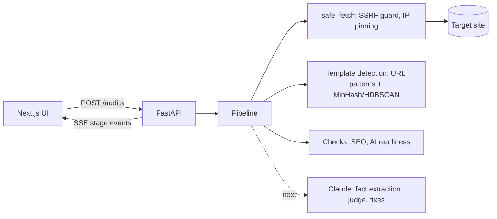

# SEOGEO Audit Kit

**SEO and GEO (AI search) audits for programmatic sites, reported per template.**

A programmatic site has thousands of pages but only a handful of templates. SEOGEO Audit Kit
finds the templates behind a sitemap, checks a few representative pages from each, and tells
you what to fix — with how many pages each fix covers.

> **Status:** work in progress. The audit engine runs end to end on real sites; the UI still
> shows sample data and the Claude-powered checks are next. See [`FEATURES.md`](FEATURES.md).

## What it does

```
sitemap.xml ──► sample URLs ──► detect templates ──► crawl samples ──► checks ──► ranked fixes
                 (fair across     (URL patterns +      (robots.txt,     (SEO, AI
                  every file)      page structure)      rate-limited)    readiness)
```

| Stage | How |
|---|---|
| **Sitemap ingest** | Follows sitemap indexes and gzip. Big sites split sitemaps by type (`listings__001…180`), so URLs are sampled across every file family and weighted back up to estimate pages per template. |
| **Template detection** | Signal 1: URL patterns (`/buildings/{slug}`, `{id}`, `{uuid}`), with facet siblings merged. Signal 2: page structure — shallow tag paths plus a *heading skeleton* ("Reviews of 25 Main St" → "reviews of") — compared with MinHash and clustered with HDBSCAN. URL patterns that hide different layouts are split; siblings sharing a layout are merged. |
| **Crawl** | Respects robots.txt and Crawl-delay, paces requests per host, identifies as `SEOGEOAuditKitBot`. |
| **Technical SEO** | Status, sitemap redirects, noindex in sitemap, canonicals, titles and descriptions, headings, thin content, boilerplate share, image alt, lang, hreflang, lastmod freshness, response time. |
| **AI readiness (GEO)** | AI-crawler policy (retrieval vs training bots), llms.txt structure, JSON-LD present / parses / has a main entity / required properties / no placeholder values, dateModified freshness, quotable verdict sentence, facts up front. |
| **Scoring** | Each finding is measured on samples and scaled to the template's estimated pages; scores are weighted by template size. |

## The 13 modules

| Audit | Connect | Track |
|---|---|---|
| Technical SEO · Core Web Vitals · AI readiness · What AI sees (with vs without JavaScript) · Fix generators | Google Search Console · Bing Webmaster · AI referral traffic | AI visibility (citations, share of voice) · AI crawler logs · Monitoring and alerts · Question gaps · GitHub Action and MCP server |

The hosted demo runs on Claude and free APIs. Tracking citations in ChatGPT, Perplexity,
Gemini and Copilot is built in, using your own API keys when self-hosted.

## Architecture



- **Safe by default:** every user-supplied URL goes through one fetcher that blocks private,
  loopback and cloud-metadata addresses, re-checks each redirect, and connects to the exact IP it
  vetted (so DNS rebinding can't slip through). Responses and XML are size-capped; XML is parsed
  with `defusedxml`.
- **Costs visible:** rules and ML run first for free; Claude only reads sample pages. Every
  stage reports its time and cost.

## Run it locally

Requirements: Python 3.12+ with [uv](https://docs.astral.sh/uv/), Node 20+ with pnpm.

```bash
# API — http://localhost:8001
cd api
uv sync
cp .env.example .env
uv run uvicorn app.main:app --reload --port 8001

# UI — http://localhost:3001
cd web
pnpm install
pnpm dev --port 3001
```

Run an audit from the command line and stream its stages:

```bash
ID=$(curl -s -X POST localhost:8001/audits -H 'Content-Type: application/json' \
  -d '{"url":"https://example.com"}' | python3 -c 'import json,sys;print(json.load(sys.stdin)["id"])')
curl -N localhost:8001/audits/$ID/events
```

## Smart sampling and limits

A template's problems repeat on every page built from it, so the audit doesn't need every
page. It reads a fair sample of sitemap files across every family, keeps a spread of URLs
from each, checks about 5 representative pages per template, and scales the counts back up.
The report shows exactly how pages were counted, per sitemap family. On a 1.3M-page site the
estimate was within 0.7% of a full count, and the audit took about 2.5 minutes.

**Count every page** (on any report, or `POST /audits/{id}/count`) reads every sitemap file
and replaces the estimates with exact counts. It only counts URLs, so the findings don't
change and memory stays flat even for millions of pages.

The hosted demo keeps the defaults below so audits stay fast and free. When self-hosting,
raise them in `api/.env`:

| Setting | Default | What it controls |
|---|---|---|
| `MAX_SITEMAPS` | `50` | Sitemap files read per audit; the rest of each family is estimated |
| `MAX_URLS` | `5000` | Sitemap URLs kept for template detection |
| `CRAWL_PER_TEMPLATE` | `6` | Pages fetched per URL pattern to detect layouts |
| `SAMPLES_PER_TEMPLATE` | `5` | Pages each check runs on, per template |
| `MAX_COUNT_FILES` | `2000` | Ceiling for "Count every page" |

To audit one section in more depth, pass a single child sitemap (for example
`https://example.com/sitemap_products_042.xml`) instead of the main one.

## Tests

```bash
cd api && uv run pytest && uv run ruff check app tests
```

Covers the SSRF guard (private IPs, redirects to internal hosts), XML bombs, sitemap sampling
and weighting, template detection and layout clustering, and every SEO and AI-readiness check.

## Stack

Python · FastAPI · httpx · selectolax · defusedxml · scikit-learn (HDBSCAN, t-SNE) · datasketch
(MinHash) · Anthropic SDK · Next.js 15 · TypeScript · Tailwind v4

## License

[MIT](LICENSE) © 2026 Jay Lahoti
