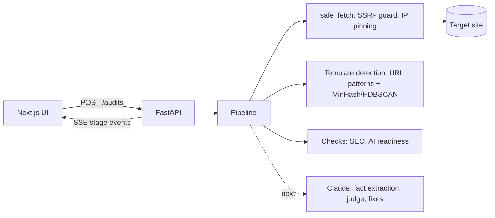

# SEOGEO Audit Kit

**SEO and GEO (AI search) audits for programmatic sites, reported per template.**

A programmatic site has thousands of pages but only a handful of templates. SEOGEO Audit Kit
finds the templates behind a sitemap, checks a few representative pages from each, and tells
you what to fix — with how many pages each fix covers.

> **Status:** work in progress. Full audits run end to end on real sites, including the Claude
> checks; account connections (Search Console, Bing, analytics) are next. See [`FEATURES.md`](FEATURES.md).

## What it does

```
sitemap.xml ──► sample URLs ──► detect templates ──► crawl samples ──► checks ──► ranked fixes
                 (fair across     (URL patterns +      (robots.txt,     (SEO, AI
                  every file)      page structure)      rate-limited)    readiness)
```

| Stage | How |
|---|---|
| **Sitemap ingest** | Follows sitemap indexes and gzip. Big sites split sitemaps by type (`listings__001…180`), so URLs are sampled across every file family and weighted back up to estimate pages per template. |
| **Template detection** | Signal 1: URL patterns (`/buildings/{slug}`, `{id}`, `{uuid}`), with facet siblings merged. Signal 2: page structure — shallow tag paths plus a *heading skeleton* ("Reviews of 25 Main St" → "reviews of") — compared with MinHash and clustered with HDBSCAN. URL patterns that hide different layouts are split; siblings sharing a layout are merged. |
| **Crawl** | Respects robots.txt and Crawl-delay, paces requests per host, identifies as `SEOGEOAuditKitBot`. |
| **Technical SEO** | Status, sitemap redirects, noindex in sitemap, canonicals, titles and descriptions, headings, thin content, boilerplate share, image alt, lang, hreflang, lastmod freshness, response time. |
| **AI readiness (GEO)** | AI-crawler policy (retrieval vs training bots), llms.txt structure, JSON-LD present / parses / has a main entity / required properties / no placeholder values, dateModified freshness, quotable verdict sentence, facts up front. |
| **Scoring** | Each finding is measured on samples and scaled to the template's estimated pages; scores are weighted by template size. |

## The 13 modules

| Audit | Connect | Track |
|---|---|---|
| Technical SEO · Core Web Vitals · AI readiness · What AI sees (with vs without JavaScript) · Fix generators | Google Search Console · Bing Webmaster · AI referral traffic | AI visibility (citations, share of voice) · AI crawler logs · Monitoring and alerts · Question gaps · GitHub Action and MCP server |

The hosted demo runs on Claude and free APIs. Tracking citations in ChatGPT, Perplexity,
Gemini and Copilot is built in, using your own API keys when self-hosted.

## Architecture



- **Safe by default:** every user-supplied URL goes through one fetcher that blocks private,
  loopback and cloud-metadata addresses, re-checks each redirect, and connects to the exact IP it
  vetted (so DNS rebinding can't slip through). Responses and XML are size-capped; XML is parsed
  with `defusedxml`.
- **Costs visible:** rules and ML run first for free; Claude only reads sample pages. Every
  stage reports its time and cost.

## Run it locally

Requirements: Python 3.12+ with [uv](https://docs.astral.sh/uv/), Node 20+ with pnpm.

```bash
# API — http://localhost:8001
cd api
uv sync
cp .env.example .env
uv run uvicorn app.main:app --reload --port 8001

# UI — http://localhost:3001
cd web
pnpm install
pnpm dev --port 3001
```

Or run everything (API, website, Postgres) with Docker:

```bash
cp api/.env.example api/.env   # add ANTHROPIC_API_KEY to enable the Claude checks
docker compose up --build      # then open http://localhost:3001
```

Run an audit from the command line and stream its stages:

```bash
ID=$(curl -s -X POST localhost:8001/audits -H 'Content-Type: application/json' \
  -d '{"url":"https://example.com"}' | python3 -c 'import json,sys;print(json.load(sys.stdin)["id"])')
curl -N localhost:8001/audits/$ID/events
```

## Smart sampling and limits

A template's problems repeat on every page built from it, so the audit doesn't need every
page. It reads a fair sample of sitemap files across every family, keeps a spread of URLs
from each, checks about 5 representative pages per template, and scales the counts back up.
The report shows exactly how pages were counted, per sitemap family. On a 1.3M-page site the
estimate was within 1% of a full count (1,356,128 vs 1,345,411), and the audit took about 2.5 minutes.

**Count every page** (on any report, or `POST /audits/{id}/count`) reads every sitemap file
and replaces the estimates with exact counts. It only counts URLs, so the findings don't
change and memory stays flat even for millions of pages.

The hosted demo keeps the defaults below so audits stay fast and free. When self-hosting,
raise them in `api/.env`:

| Setting | Default | What it controls |
|---|---|---|
| `MAX_SITEMAPS` | `50` | Sitemap files read per audit; the rest of each family is estimated |
| `MAX_URLS` | `5000` | Sitemap URLs kept for template detection |
| `CRAWL_PER_TEMPLATE` | `6` | Pages fetched per URL pattern to detect layouts |
| `SAMPLES_PER_TEMPLATE` | `5` | Pages each check runs on, per template |
| `MAX_COUNT_FILES` | `2000` | Ceiling for "Count every page" |

To audit one section in more depth, pass a single child sitemap (for example
`https://example.com/sitemap_products_042.xml`) instead of the main one.

## Command line, GitHub Action and MCP

**CLI** — runs the same audit without the web app (from `api/`):

```bash
uv run seogeo-audit audit example.com
uv run seogeo-audit audit example.com --fail-on "geo<60,high-issues>0,missing-jsonld" --json report.json
uv run seogeo-audit page https://example.com/some/page     # one page, in seconds
```

Exit code 1 when a `--fail-on` rule fails, 2 when the audit can't run. Rules: `geo<N`, `seo<N`,
`ai<N`, `visibility<N`, `high-issues>N`, `missing-jsonld`.

**GitHub Action** — audit a preview deployment on every pull request and fail it on regressions:

```yaml
- uses: jaylahoti/seogeo-audit-kit/action@main
  with:
    url: ${{ steps.deploy.outputs.preview-url }}
    fail-on: "geo<60,missing-jsonld"
    anthropic-api-key: ${{ secrets.ANTHROPIC_API_KEY }}   # optional: enables the Claude checks
```

The summary is written to the job's summary page; the full JSON report is an output.

**MCP server** — use the audit from Claude Code, Cursor or any MCP client:

```bash
claude mcp add seogeo -- uvx --from "git+https://github.com/jaylahoti/seogeo-audit-kit#subdirectory=api" seogeo-audit-mcp
```

Tools: `audit_site`, `get_report`, `get_page_type` (findings and ready-to-paste fixes), `check_page`, `get_llms_txt`.

## Claude, cost and limits

Claude runs only on sample pages, with a hard budget per audit (`MAX_AUDIT_COST_USD`, default $0.50):

| Step | Model | Calls | Typical cost |
|---|---|---|---|
| Page checks: key facts, verdict sentence, facts up front, title intent, questions | Haiku | ~5 per page type | ~$0.05 |
| AI visibility: questions asked with web search; cited / found / missing | Haiku + web search | ~10 | ~$0.08 |
| Judge: summary, top fixes, verdict / title / JSON-LD per page type (JSON-LD validated) | Sonnet | 1 | ~$0.05 |

On a 1.35M-page site a full audit cost $0.17 — sending every page through Sonnet would cost about $14,900.
Quotes Claude returns are checked against the page text, and generated JSON-LD must parse and include
the required properties for its type before it's shown. Without `ANTHROPIC_API_KEY` the audit still runs
on rules, ML and the headless browser, and the Claude stages are skipped.

**Public-demo limits.** The hosted demo allows 3 audits per visitor per day (`FREE_AUDITS_PER_DAY`) and a
total Claude budget per 24 hours (`DAILY_BUDGET_USD`, default $5). When the budget is used up, audits still run
on rules, ML and the browser, and the report says Claude was skipped. Visitors are counted by a salted hash of
their IP; the IP itself isn't stored. Requests from localhost are never limited, and Docker Compose turns both
limits off.

Search Console, Bing Webmaster and AI referral traffic are **coming soon**: they need the site owner's own
accounts, so the hosted demo shows a labelled preview with sample data.

You can see all of this in the app:

- **While it runs:** the progress screen shows Claude's cost so far, per step, against the budget.
- **Under the hood** (in every report): how many pages reach each step, which model did what with its tokens and cost, and what everything else cost ($0).
- **Why?** on each Claude finding: what Claude was shown for each sample page, what it answered, and whether its quote passed the on-page check. In one test run, 18 of 57 quoted sentences weren't on the page and were dropped.
- **/how-it-works:** the pipeline, model routing and guardrails on one public page.

## AI crawlers from your logs

In a report, open **AI crawlers** and upload an access log: nginx/Apache combined format, or JSON lines from a
Vercel log drain or Cloudflare Logpush (plain or `.gz`, up to 50 MB). You get requests per bot and page type,
errors served to bots, who fetched `llms.txt`, and the share of each page type that any AI bot fetched.
Google, Bing and Apple are verified with forward-confirmed reverse DNS, and requests that fail are counted as
fake and left out. Only the totals are saved; the log is discarded. **Try a synthetic log** shows the analysis
with invented traffic, clearly labelled.

## Other AI engines (self-hosted)

Set `OPENAI_API_KEY`, `PERPLEXITY_API_KEY` or `GEMINI_API_KEY` and the questions Claude searched are also asked
to ChatGPT (Responses API with web search), Perplexity (Sonar) and Gemini (Google Search grounding), each
classified the same way (cited / found / missing). The visibility score pools every engine. Calls are billed to
those keys; the hosted demo sets none. The response parsers are tested on recorded response shapes, but haven't
been run against live keys yet.

## Evals

```bash
cd api
uv run python -m evals.run            # offline: page types, rule checks, heuristics
uv run python -m evals.run --claude   # also Claude's page checks (~$0.02 of Haiku)
```

The pipeline runs on three generated sites (real estate, shop, jobs) where the right answers are known: page
types (including one URL pattern hiding two layouts and two patterns sharing one), planted bugs, and pages with
and without a quotable summary. Results go to `web/lib/evals.json` and show in the ML Lab and on /how-it-works.

| Measure | Score |
|---|---|
| Page types, adjusted Rand index (1.0 = perfect) | 0.83 (URL patterns alone: 0.82) |
| Estimated pages per type, mean error | 1.1% |
| Rule checks, precision / recall | 1.00 / 0.95 |
| "Is there a quotable summary?" — heuristic vs Claude Haiku (Cohen's κ, same 40 pages) | 0.36 vs 0.80 |

Known misses the evals show: two URL sections sharing one layout stay separate page types, and a bug on only
some pages of a type can be missed when none of the samples have it. `tests/test_evals.py` fails if the scores
drop, and CI runs it on every push. The sites are synthetic, so these are a regression gate, not a claim about
every real site.

## Saved audits and monitoring

Audits are saved to a database (SQLite by default, Postgres via `DATABASE_URL`), so reports survive
restarts. Each audit is compared with the site's previous one — score drops, new and fixed issues, newly
blocked AI bots — and `POST /monitors {"url": "example.com", "every_hours": 168, "webhook_url": "…"}`
re-audits on a schedule and posts regressions to a Slack-compatible webhook.

## Tests

```bash
cd api && uv run pytest && uv run ruff check app tests
```

Covers the SSRF guard (private IPs, redirects to internal hosts), XML bombs, sitemap sampling
and weighting, template detection and layout clustering, and every SEO and AI-readiness check.

## Stack

Python · FastAPI · httpx · selectolax · defusedxml · scikit-learn (HDBSCAN, t-SNE) · datasketch
(MinHash) · Anthropic SDK · Next.js 15 · TypeScript · Tailwind v4

## License

[MIT](LICENSE) © 2026 Jay Lahoti
